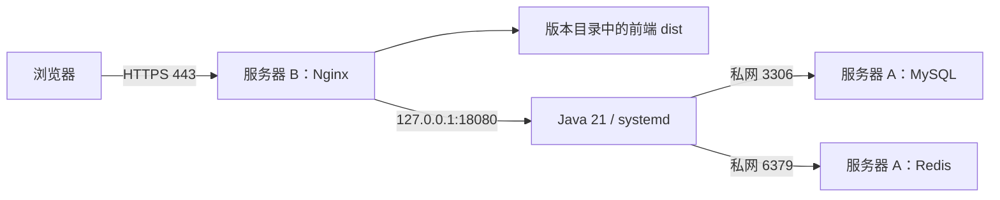

# JEECG 两台服务器部署手册

编写日期：2026-11-06。基线：JeecgBoot v3.9.5，提交 `e3b9dc0aefe1943d9772b026f64ed671a7c82802`，Vue3 前端、Java 21 单体后端。

本文按已确认的 Ubuntu 24.04 LTS、同一可信私网编写。配置已按当前源码核对，尚未登录目标服务器部署。文中的 IP、域名、镜像和密码均须替换为实际值。

## 1. 服务器分工与网络

| 项目 | 中间件服务器 A | 应用服务器 B |
| --- | --- | --- |
| 示例私网 IP | 10.20.0.10 | 10.20.0.11 |
| 运行内容 | Docker Compose：MySQL 8.0、Redis 7.2 | Nginx：前端静态文件、HTTPS；systemd：Java 21 后端 |
| 初始资源建议 | 4 核、8 GB 内存、100 GB SSD 起 | 4 核、8 GB 内存、60 GB SSD 起 |
| 存储 | 数据库、Redis 持久化文件 | 发布包、上传文件、代码模板、日志 |
| 公网入口 | 无业务公网端口 | 80、443；域名 admin.example.com 指向 B |

资源是初期预算，容量要根据上传量、数据库增长、并发与备份保留期调整。两台服务器是职责拆分，任何一台故障都会影响服务，不具备高可用。



首期不部署 Nacos、RabbitMQ、Kafka、Elasticsearch、XXL-Job、MinIO 或向量库；现有业务不依赖它们。上传暂存 B，另做异机备份。AI、报表设计器等在本模板中先关闭入口；需要这些能力时逐项完成组件、权限和依赖验收后开放。

可选 ClickHouse 统计接入使用独立 `deploy/clickhouse` Compose 项目，运行说明见 `clickhouse-runbook.md`。最新同机方案把 Java、MySQL、Redis、ClickHouse 放在同一宿主机，ClickHouse HTTP仅绑定loopback18123；旧的两服务器初始资源预算不能据此沿用。跨机器统计服务须独立配置受限私网HTTPS入口及备份，不能直接扩大本模板端口暴露范围。

| 入站规则 | 来源 | 目标 |
| --- | --- | --- |
| SSH 22 | 运维固定 IP 或堡垒机 | A、B |
| TCP 3306、6379 | 仅 B 的私网 IP | A 的私网 IP |
| TCP 80、443 | 使用者；内部后台优先限制 VPN/办公网 | B |
| TCP 18080 | 只监听 B 本机 | 不对外开放 |

A 的 Docker 端口只绑定私网 IP，同时配置云安全组/宿主机 Docker 转发链防火墙；不要只依赖 UFW 的普通 INPUT 规则保护 Docker 发布端口。若应用经 Docker NAT 出网，数据库账户的来源限制应按实际观察到的源 IP 设置。跨不可信网络时先配置 VPN，或验证 MySQL/Redis TLS；本文 JDBC 示例不加密私网链路。

## 2. 目录、软件与配置来源

仓库配置位于 `deploy/production`。Linux 服务器上的文件用 LF 换行，不把 Windows 本地路径复制到服务器。

```text
A /opt/jeecg-middleware/       compose.yaml、.env、redis.conf、redis-users.acl、secrets/
A /srv/jeecg/mysql/           数据库持久化目录
A /srv/jeecg/redis/           Redis AOF/RDB
A /srv/jeecg/backups/         数据库备份暂存
B /opt/jeecg/releases/<版本>/ backend/jeecg.jar、frontend/、校验文件
B /opt/jeecg/current          指向当前版本的符号链接
B /etc/jeecg/                application-server.yml、jeecg.env
B /srv/jeecg/                uploads/、webapp/、work/、backups/
```

A 安装 Docker Engine 与 Compose 插件，按 Docker 官方 Ubuntu 安装指南执行并固定经验证的版本。不要将 Windows Docker Desktop 当作服务器运行时。安装后检查 `docker version`、`docker compose version`，设置 `systemctl enable --now docker`。

A 还需安装文中使用的工具：`sudo apt-get update && sudo apt-get install -y openssl gzip`。两台服务器均启用时间同步并检查 `timedatectl status`。

B 安装运行依赖（root 或 sudo）：

```bash
sudo apt-get update
sudo apt-get install -y openjdk-21-jre-headless nginx curl unzip rsync
java -version
nginx -v
```

B 运行原 JEECG 静态前端与 Java 后台时无需安装 Node、pnpm、Maven，不使用 Vite 13100 开发服务器提供生产页面。构建在开发机或 CI 完成，服务由 systemd 和 Nginx 常驻管理。新增独立站点分流执行器时，B 另需固定版本的 Node24 运行时和专用 systemd 服务，见 `routing-publication-runbook.md`；不需要安装 npm 运行依赖。

## 3. 准备同版本发布包

在当前工作区 `upstream/JeecgBoot` 的受控分支构建；保留已验证的锁文件 registry 调整，不使用浮动 main。

1. 前端 `src/utils/encryption/signMd5Utils.js` 中的 `signatureSecret` 更换为本项目值，并与 B 的 `JEECG_SIGNATURE_SECRET` 保持一致。该值最终进入浏览器，不能代替鉴权或作为数据库密码。
2. 前端目录创建不提交的 `.env.production.local`：

```dotenv
VITE_USE_MOCK=false
VITE_PUBLIC_PATH=/
VITE_GLOB_API_URL=/jeecgboot
VITE_GLOB_DOMAIN_URL=https://admin.example.com/jeecgboot
VITE_GLOB_APP_OPEN_SSO=false
VITE_GLOB_APP_OPEN_QIANKUN=false
VITE_GLOB_ICONIFY_USE_TYPE=local
```

3. 编译后端（Linux CI 示例，已配置 JAVA_HOME 为 JDK 21）：

```bash
cd jeecg-boot
mvn -B -pl jeecg-module-system/jeecg-system-start -am package -DskipTests
```

4. 编译前端：

```bash
cd jeecgboot-vue3
pnpm install --frozen-lockfile --ignore-scripts
pnpm build
```

命令应从各自目录运行；构建机工具版本参考 `docs/baseline/local-runbook.md`。若使用 Windows 当前环境，沿用其中 JDK 21、esbuild 路径设置及 Maven 缓存参数。上游默认跳过后端测试，打包成功不等于测试通过；实际上线前执行资源隔离与登录验收。

5. 打包：后端 JAR 重命名为 `backend/jeecg.jar`；完整 `dist/` 内容放入 `frontend/`。务必包含 `index.html`、`_app.config.js`、`assets/`、`js/` 和 `chat/`。生成 `SHA256SUMS`，记录提交号、构建时间和依赖版本。
6. 检查 `frontend/_app.config.js` 中 URL 为生产域名，不能出现 `127.0.0.1:8080`、`localhost:3100` 或 Docker 内部主机名。VITE_GLOB_DOMAIN_URL 会被浏览器使用，不能填写 A 的私网地址。

## 4. 部署服务器 A：中间件

以下在 A 执行。把仓库 `deploy/production/middleware/` 上传到 `/opt/jeecg-middleware/`，只操作本项目新建数据目录。

```bash
sudo mkdir -p /opt/jeecg-middleware/secrets /srv/jeecg/mysql /srv/jeecg/redis /srv/jeecg/backups
cd /opt/jeecg-middleware
sudo cp .env.example .env
sudo chmod 700 secrets
```

编辑 `.env`：私网 IP 替换为 A；初始 MySQL 候选为 8.0.46、Redis 7.2，上线时固定已拉取并验收的不可变镜像摘要。检查目标 CPU 架构、镜像可获取性和补丁状态，不因示例标签存在就假定是最新安全版本。

root 下生成三份独立随机密码（不打印到终端、不进版本库）：

```bash
sudo -i
cd /opt/jeecg-middleware
umask 077
openssl rand -hex 32 > secrets/mysql_root_password
openssl rand -hex 32 > secrets/mysql_app_password
openssl rand -hex 32 > secrets/redis_password
redis_password=$(cat secrets/redis_password)
printf 'user default on >%s ~* &* +@all\n' "$redis_password" > redis-users.acl
unset redis_password
chmod 600 secrets/*
# Redis 镜像内部用户需可读 ACL；目录保持仅运维可进入。
chmod 644 redis-users.acl redis.conf
chmod 700 /opt/jeecg-middleware
docker compose config --quiet
docker compose up -d --wait --wait-timeout 180
docker compose ps
```

Compose secret 仅配置文件挂载，不是独立的密钥管理服务。Redis 使用独立实例的 default 用户和密码，兼容 Spring Redis、Redisson；不是与其他应用共享实例。healthcheck 的 NOAUTH 只证明 Redis 存活且要求认证，后续还要验证带密码 PING。

### 4.1 初始化数据库

只在首次空库执行。上传当前标签的 `jeecg-boot/db/jeecgboot-mysql-5.7.sql` 到 A 的 `/opt/jeecg-middleware/init/jeecg.sql`。文件名含 5.7，但本地已在 MySQL 8.0 导入验证。脚本含建表/覆盖语句，禁止导入到已有生产库。

先确认 `jeecg-boot` 库不存在或为空，再执行：

```bash
cd /opt/jeecg-middleware
docker compose exec -T mysql sh -c 'MYSQL_PWD="$(cat /run/secrets/mysql_root_password)" exec mysql -uroot' < init/jeecg.sql
app_password=$(cat secrets/mysql_app_password)
docker compose exec -T mysql sh -c 'MYSQL_PWD="$(cat /run/secrets/mysql_root_password)" exec mysql -uroot' <<SQL
CREATE USER 'jeecg_app'@'10.20.0.11' IDENTIFIED BY '${app_password}';
GRANT SELECT, INSERT, UPDATE, DELETE ON \`jeecg-boot\`.* TO 'jeecg_app'@'10.20.0.11';
SQL
unset app_password
docker compose exec -T mysql sh -c 'MYSQL_PWD="$(cat /run/secrets/mysql_root_password)" exec mysql -uroot -Nse "SELECT COUNT(*) FROM information_schema.tables WHERE table_schema=0x6a656563672d626f6f74"'
```

SQL 中 B IP 必须替换。线上应用账号仅 CRUD，不给全局权限、root 或建表权限；Online 建模和数据库迁移留在测试/发布流程。若组件启动确实要求额外权限，先定位失败 SQL，再决定关闭组件或最小授权，不直接给 ALL。

若发布包包含新增“站点资源”模块，基线库导入后由迁移账号额外执行 `jeecg-boot/db/site-platform/V20261106_1__site_resources.sql`，按 `docs/deployment/site-resources-runbook.md` 完成安装与授权。此 SQL 不在上游自动 Flyway 目录内。业务账户的库级 CRUD 允许修改审计表；如要数据库层面限制只追加，必须按该手册收敛原有库级授权，再逐表授权，不能只增加表级 GRANT。

Redis 带认证检查：

```bash
REDISCLI_AUTH=$(cat secrets/redis_password) docker compose exec -T -e REDISCLI_AUTH redis redis-cli ping
```

应返回 PONG。通过安全渠道把应用数据库密码、Redis 密码配置到 B 的环境文件，不复制 root 密码到 B。

## 5. 部署服务器 B：前后端

### 5.1 用户、目录与首次版本

```bash
sudo useradd --system --home /srv/jeecg --shell /usr/sbin/nologin jeecg
sudo install -d -o jeecg -g jeecg -m 750 /srv/jeecg /srv/jeecg/work /srv/jeecg/logs /srv/jeecg/uploads /srv/jeecg/webapp /srv/jeecg/backups
sudo install -d -m 755 /opt/jeecg/releases
sudo install -d -m 750 -o root -g jeecg /etc/jeecg
```

若账号已存在，检查后复用，不重复创建。上传完整发布目录到 `/opt/jeecg/releases/3.9.5-20261106-01/`，核对 `sha256sum -c SHA256SUMS`。代码包保持 root 所有、目录可遍历、静态文件可读，应用用户不能改写发布包。

```bash
sudo chown -R root:root /opt/jeecg/releases/3.9.5-20261106-01
sudo chmod -R u=rwX,go=rX /opt/jeecg/releases/3.9.5-20261106-01
sudo ln -s /opt/jeecg/releases/3.9.5-20261106-01 /opt/jeecg/current
```

首次没有 current 才执行 `ln -s`。后续切换按第 8 节操作。

### 5.2 环境与后端配置

将模板复制到目标位置：

| 模板 | 目标 |
| --- | --- |
| application/application-server.yml | /etc/jeecg/application-server.yml |
| application/jeecg.env.example | /etc/jeecg/jeecg.env |
| application/jeecg.service | /etc/systemd/system/jeecg.service |
| application/nginx-jeecg.conf | /etc/nginx/conf.d/jeecg.conf |

编辑 `jeecg.env`，填写 A 的私网地址、数据库密码、Redis 密码、访问域名和前端一致的签名值；示例密码统一使用 hex，无空格。不要在 systemd ExecStart 或聊天中传数据库密码。

```bash
sudo chown root:jeecg /etc/jeecg/jeecg.env /etc/jeecg/application-server.yml
sudo chmod 640 /etc/jeecg/jeecg.env /etc/jeecg/application-server.yml
sudo systemd-analyze verify /etc/systemd/system/jeecg.service
sudo systemctl daemon-reload
sudo systemctl enable --now jeecg
sudo systemctl status jeecg --no-pager
sudo journalctl -u jeecg -n 100 --no-pager
```

JVM 初始 1 GB、最大堆 2 GB，必须给堆外内存、Nginx 和系统留余量。systemd 异常退出自动重启，连续失败达到限制后先查日志；修复后执行 `systemctl reset-failed jeecg`、`systemctl start jeecg`。

上游 Logback 使用 `../logs`，本服务工作目录设为 `/srv/jeecg/work`，因此文件日志写入 `/srv/jeecg/logs`。同时检查文件日志滚动保留、journald 占用和磁盘告警，避免两份日志长期增长。

注意模板同时覆盖 Spring Redis 和 `jeecg.redisson`，避免锁组件仍连接 localhost。`prod` 使用本地上传替代上游默认 alioss；上传和生成模板保存在 `/srv/jeecg`，不会随版本切换丢失。后台只监听回环，公网无法绕过 Nginx 访问注册与调试入口。

### 5.3 HTTPS、前端与 Nginx

域名 A/AAAA 记录指向 B；没有可用 IPv6 时不要留错误 AAAA 记录。将有效证书完整链和私钥安全放在：

```text
/etc/nginx/tls/jeecg/fullchain.pem
/etc/nginx/tls/jeecg/privkey.pem
```

私钥 root:root、600，路径目录 root 可访问。证书通过云厂商或 ACME DNS 验证获取，设置到期告警和续期后 `nginx -t && systemctl reload nginx`。模板证书不存在时 `nginx -t` 会失败；先准备证书再启用该配置。

替换 Nginx 模板全部 `admin.example.com`。Ubuntu 的 `conf.d/*.conf` 位于 http 上下文，支持模板顶层 map。检查是否存在同域名重复 server 配置。

```bash
sudo nginx -t
sudo systemctl enable --now nginx
sudo systemctl reload nginx
```

请求映射：`https://admin.example.com/jeecgboot/sys/login` → B 本机 `http://127.0.0.1:18080/jeecg-boot/sys/login`。页面 history 路由通过 `try_files` 回到 index.html；JS/CSS 不存在时返回真实 404，不能回成 HTML。WebSocket 升级头和长请求超时已配置。若以后增加 CDN/LB，重新配置可信代理链，不能盲信客户端传入的 X-Forwarded-For。

本模板在入口拒绝开放注册、AI、报表、大屏、示例、监控和接口调试路径；对应菜单可能仍可见。入口封禁不能替代业务接口授权或组件修复，也不应被视为完整路径安全审计。对公开后台建议先加 VPN/办公 IP 限制，首次登录后由管理员修改默认密码和清理示例账号。

## 6. 上线验收

先从 B 验证到 A 的网络，再逐层检查，不只看 systemctl 的 active。

```bash
# B 本机后端可用性
curl -fsS http://127.0.0.1:18080/jeecg-boot/sys/randomImage/deploy-check
# 域名代理、证书有效性；不要用 -k 跳过证书校验
curl -fsS https://admin.example.com/jeecgboot/sys/randomImage/deploy-check
curl -I https://admin.example.com/
curl -I https://admin.example.com/online/cgform
# 未登录必须拒绝
curl -s -o /dev/null -w '%{http_code}\n' https://admin.example.com/jeecgboot/sys/user/list
# 不开放注册与敏感组件
curl -s -o /dev/null -w '%{http_code}\n' https://admin.example.com/jeecgboot/sys/user/register
curl -s -o /dev/null -w '%{http_code}\n' https://admin.example.com/jeecgboot/jmreport/list
```

验证码接口应业务成功；用户列表未认证为 401，注册和报表入口为 403。还需在浏览器验收登录及验证码、字典签名、刷新深层页面、上传下载、权限、日志脱敏。重启 B 验证 Nginx/Java 自启动，重启 A 验证 Docker 容器恢复；维护窗口做，不能在活跃业务中直接重启。

当前代码的系统多租户控制默认 false；部署完成不会自动实现站点、租户、字段隔离。业务模块与发布回滚仍处于后续建设范围，不得将安装平台当作这些需求已交付。

## 7. 备份与恢复

建议目标由业务确认：例如每天全量、保留 7 天本机和 30 天异机；如要求 RPO 小于 24 小时，需将 binlog 持续归档到异机并演练时间点恢复。当前 binlog 本机保留 7 天，不能保护整台 A 丢失。

A 上全量备份（root，B 进入维护/停止业务写入后更容易和文件保持一致）：

```bash
sudo -i
cd /opt/jeecg-middleware
set -euo pipefail
umask 077
backup_file="/srv/jeecg/backups/jeecg-$(date +%Y%m%d-%H%M%S).sql.gz"
docker compose exec -T mysql sh -c 'MYSQL_PWD="$(cat /run/secrets/mysql_root_password)" exec mysqldump -uroot --single-transaction --routines --events --triggers --hex-blob --set-gtid-purged=OFF --no-tablespaces --databases jeecg-boot' | gzip > "$backup_file"
gzip -t "$backup_file"
sha256sum "$backup_file" > "$backup_file.sha256"
```

备份失败必须告警，不能只看文件存在。备份 `/etc/jeecg`、发布元数据和 B 的 `/srv/jeecg/uploads`、`webapp`、`work/config`，敏感配置加密保管。上传文件与数据库有引用关系，至少使用维护窗口或一致性快照记录同一恢复点。异机目标建议对象存储/专用备份系统，不能只把备份放在同一块数据盘。

Redis AOF 保护异常重启；缓存/会话恢复策略单独决定。旧会话、分布式锁、队列不能盲目从旧快照恢复。若后续业务把 Redis 当持久业务存储，需要单独制定备份一致性方案。

恢复先在隔离环境演练：校验 SHA256、gzip → 新建空 MySQL 实例 → 导入全量 → 按需回放已校验 binlog → 恢复配套文件 → 启动匹配代码版本 → 登录、上传、权限与核心数据验收。生产恢复会覆盖数据，执行前确认恢复点、停写和恢复后数据损失范围，不直接把恢复命令当普通发布步骤。

## 8. 更新与回滚

发布目录使用唯一 ID，前后端一起切换，不覆盖 current 下的文件。

1. 预发布验证新包与数据库变更；在 B 上传新版本并校验 SHA256。
2. 备份数据库、上传文件及配置，记录旧 current 指向；通知维护窗口。
3. 数据库变更由发布 DBA 使用迁移账号执行。模板禁用生产自动 Flyway，不能把 JAR 替换当作迁移已完成。
4. 首期允许短时维护：停 Java，原子切换符号链接，启动并做验收：

```bash
readlink -f /opt/jeecg/current
sudo systemctl stop jeecg
sudo ln -s /opt/jeecg/releases/NEW_RELEASE /opt/jeecg/current.next
sudo mv -Tf /opt/jeecg/current.next /opt/jeecg/current
sudo systemctl start jeecg
sudo nginx -t
sudo systemctl reload nginx
```

`NEW_RELEASE` 必须替换为已校验目录，current.next 已存在时先检查原因，不使用自动递归删除。Nginx 和旧浏览器可能短时持有旧资源，维护后提示刷新，保留旧发布包供回滚。

5. 若失败且新旧数据库结构兼容，用同样操作将 current 指回旧版本；外置配置也恢复对应版本。数据库不兼容、已写入新格式数据或产生外部副作用时，不能只回退 JAR，要按已演练方案处理。自动恢复旧备份可能丢失新数据，不作为默认回滚。

## 9. 常见故障

| 现象 | 优先检查 |
| --- | --- |
| 整站连接拒绝 | B 的 Nginx、80/443、安全组、DNS |
| Nginx 502 | `systemctl status jeecg`、`journalctl -u jeecg`、18080 是否监听 |
| 数据库 Access denied | 应用密码、用户来源 IP、GRANT、实际数据库地址 |
| Redis NOAUTH/锁组件异常 | Spring Redis 与 Redisson 是否配置同一密码/地址 |
| 登录成功但字典签名错误 | 前后端 signatureSecret 一致、缓存及 _app.config.js |
| 页面一直 loading | 浏览器失败 JS 请求、生产 URL、缺失 _app.config.js、旧缓存 |
| 刷新子页面 404 | Nginx root、try_files、current/frontend 目录 |
| 上传丢失或无权限 | jeecg.uploadType=local、/srv/jeecg/uploads 属主、版本外持久化 |
| OOM/频繁重启 | RAM、JVM 堆外、journal、系统 OOM 日志、磁盘空间 |
| 报表/AI 返回 403 | 本方案有意关闭入口，完成组件验收再开放 |

## 10. 参考与已完成检查

- 官方 Docker Ubuntu 安装与防火墙说明：`https://docs.docker.com/engine/install/ubuntu/`
- systemd 文件系统保护说明：`https://www.freedesktop.org/software/systemd/man/latest/systemd.exec.html`
- 当前源码：`application-prod.yml`、`ShiroConfig.java`、`AiRagConfigBean.java`、`LoginController.java`、前端 `.env.production` 和 `signMd5Utils.js`。
- 本地已验证：Java 21 后端打包、前端打包、MySQL/Redis 初始化、登录页面与代理。目标两台 Ubuntu 主机的 TLS、systemd、权限、启动和恢复演练仍需现场执行。
- 本次模板检查：中间件 Compose 配置展开通过；两份 YAML 语法和重复键检查通过；生产迁移关闭、回环监听及静态资源/API 路由表达式检查通过。已核对源码中 Flyway 关闭条件、独立 Redisson 配置、日志路径和生产防火墙配置。尚未在目标 Ubuntu 上执行 `nginx -t`、`systemd-analyze verify` 或启动新模板；这些检查按第 5、6 节完成后才能认定部署通过。
